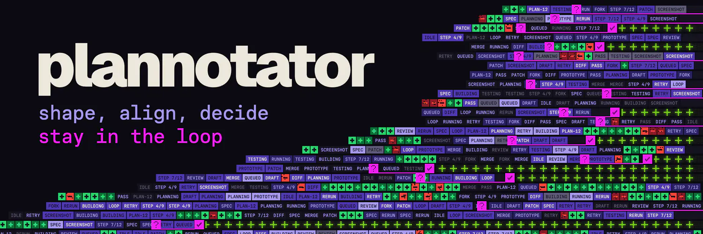
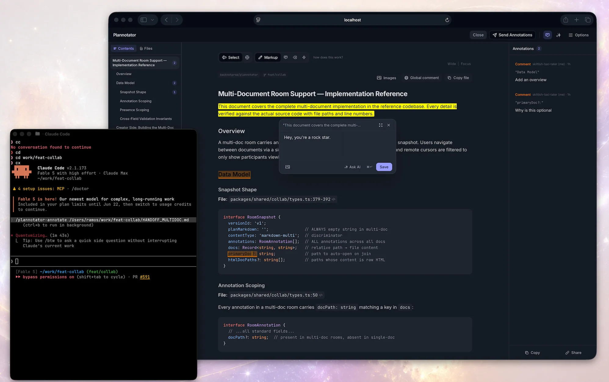
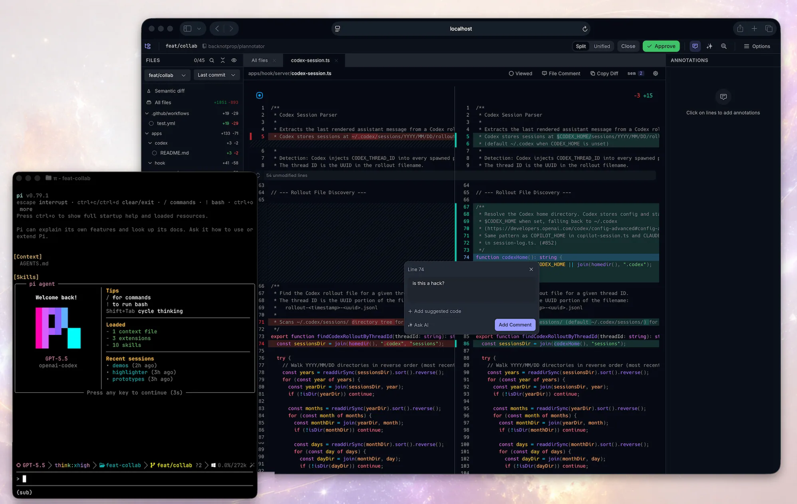
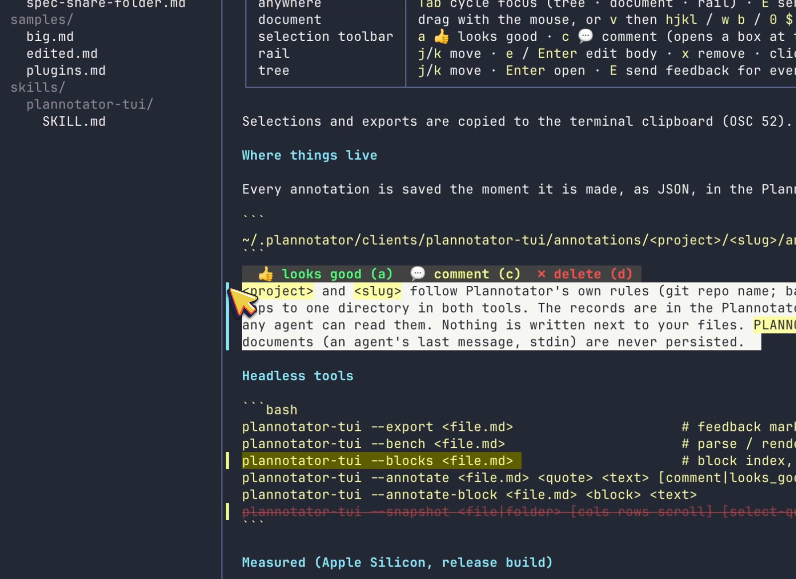
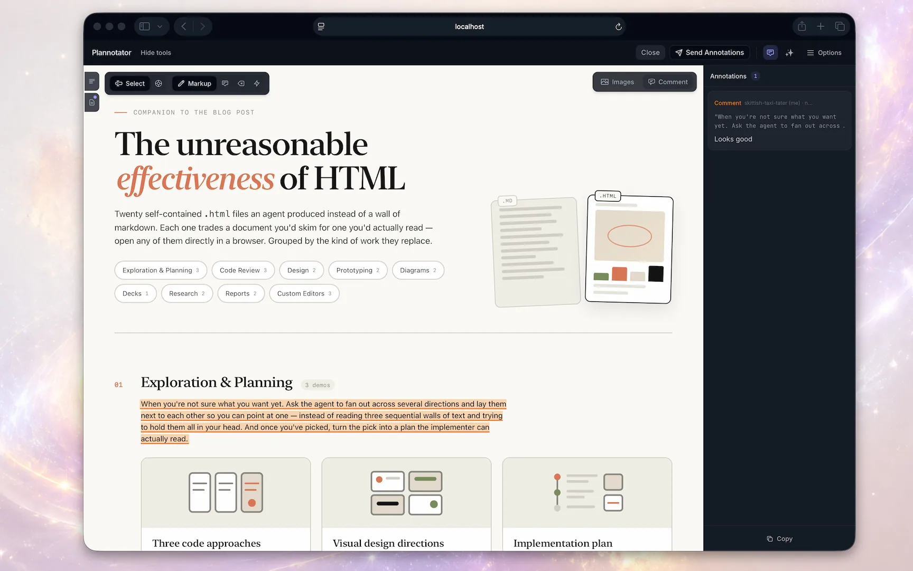
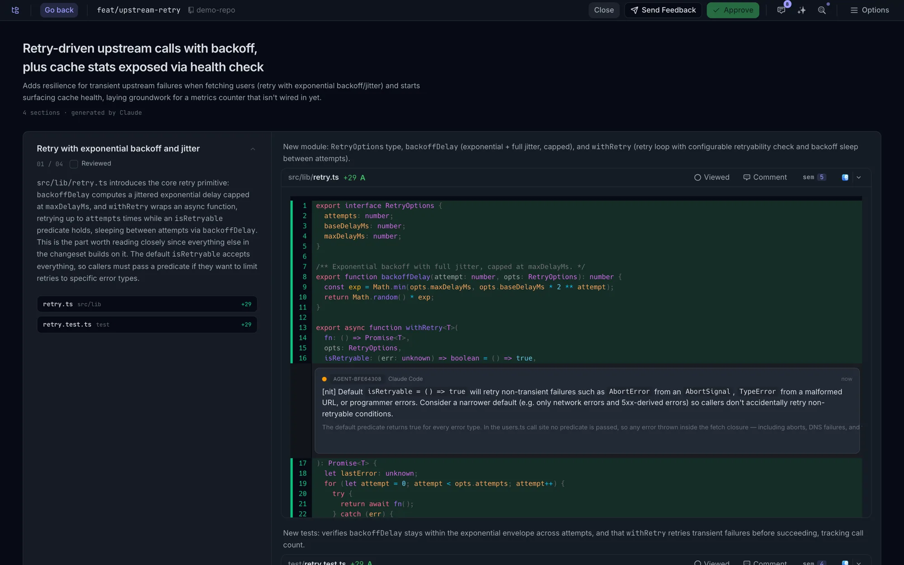
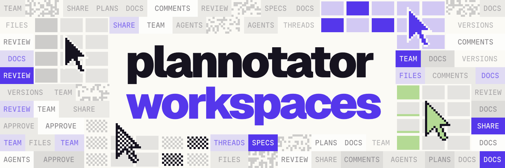

> **[中文化] plannotator**
>
> 此项目是 [backnotprop/plannotator](https://github.com/backnotprop/plannotator) 的中文翻译版本。
> - 原项目 Stars: 13224
> - 主语言: TypeScript
> - 许可证: Apache-2.0
> - 翻译日期: 2026-11-18
> - 原始 README: [README_en.md](README_en.md)
>
> 说明：下方 README 正文为**原项目文档的中文翻译**，力求忠于原文；本页顶部的「中文快速上手」为**面向中文用户的补充导读**（非原文内容），目的是让你不用读完整篇 README 就能先把项目跑起来。
>
> 如有翻译不准确之处，欢迎提 Issue 或 PR。

---


## 🚀 中文快速上手（补充导读，非原文）

### 这是什么 / 解决什么问题

Plannotator 是一个本地、基于浏览器的审阅界面，用于配合 AI 编程 agent（如 Claude Code、Codex、Copilot CLI、Gemini CLI、OpenCode 等）工作。当 agent 提出方案、计划、HTML 产物或完成改动时，它会在浏览器中打开，让你在文档、diff 或 PR 上做标注、写评论，再把反馈直接发回给 agent 执行。它解决的是「人和 agent 之间缺少一个可视化审阅与反馈回路」的问题，同时提供代码审查（本地改动或远程 PR）和 Inbox 多 agent 消息汇总能力。

### 快速上手（最短路径）

1. 安装依赖并构建（材料中 `package.json` 显示使用 Bun 工作区，脚本以 `bun run` 调用）：
   ```
   bun install
   bun run build
   ```
2. 启动 Inbox（README 给出的命令）：
   ```
   plannotator inbox
   ```
3. 若要让 Claude Code、Pi、OpenCode 接入，需通过 Plannotator 的插件连接；其他 agent 通过 MCP 接入：
   ```
   plannotator inbox mcp
   ```
4. 标注本地运行的站点（README 示例）：
   ```
   plannotator annotate http://localhost:5173
   ```
5. 终端内审阅可选装 Herdr 插件：
   ```
   herdr plugin install plannotator/herdr-annotate
   ```

> 注：材料未给出 `plannotator` 命令本身的全局安装方式（如 npm/brew 安装步骤），仅 `package.json` 的 `bin` 字段指向 `bin/plannotator.js`。具体安装命令「原文未提供明确命令，请参考下方 README 正文」。

### 环境要求

- **操作系统**：原文未说明具体支持的系统列表。
- **硬件**：原文未说明。
- **运行时/依赖**：仓库使用 Bun（存在 `bun.lock`、`bunfig.toml`，脚本均为 `bun run`）；主语言 TypeScript。Node 版本要求原文未说明。
- **浏览器**：需要一个本地浏览器来打开审阅界面（README 描述为 browser-based）。
- **版本要求**：`package.json` 中版本为 `0.29.0`；对 agent 侧（Claude Code、Codex 等）的具体版本要求原文未说明。
- 国内网络环境下安装依赖或拉取插件时，可能需要更换镜像源或使用加速下载。

### 常见坑与注意事项

- **需要配合具体 agent 使用**：核心价值依赖与 Claude Code、Codex、Copilot CLI、Gemini CLI、OpenCode、Kiro、Droid、Amp、Pi 等 agent 的插件/hooks/命令集成；不接 agent 时功能受限。
- **接入方式因 agent 而异**：Claude Code、Pi、OpenCode 走 Plannotator 插件，其他 agent 需通过 MCP（`plannotator inbox mcp`）接入，配置方式不同。
- **构建依赖 Bun 工作区**：仓库为 monorepo（`apps/*`、`packages/*`），构建脚本按子应用拆分（如 `build:hook`、`build:review`），直接跑单一命令可能不覆盖全部产物。
- **许可证为双许可**：`package.json` 标注 `MIT OR Apache-2.0`，仓库同时存在 `LICENSE-APACHE` 与 `LICENSE-MIT`，与项目信息中「Apache-2.0」不完全一致，商用前建议核对。

---


---

<p align="center">
  
</p>


<p align="center">
  <strong>标注并与智能体保持同步所需的一切</strong><br/>
  <strong>收件箱界面 • 构建产物 • 代码审查</strong><br/>
  <sub>标注计划、规格、Markdown、HTML 及其他交互式构建产物。审查 diff 和 PR。将反馈发送给智能体。</sub>
</p>

<p align="center">
  &nbsp;&nbsp;
  &nbsp;&nbsp;
  &nbsp;&nbsp;
  <picture>
    <source media="(prefers-color-scheme: dark)" srcset=".github/assets/icons/copilot-dark.svg" />
    
  </picture>&nbsp;&nbsp;
  &nbsp;&nbsp;
  &nbsp;&nbsp;
  &nbsp;&nbsp;
  <picture>
    <source media="(prefers-color-scheme: dark)" srcset=".github/assets/icons/opencode-dark.svg" />
    
  </picture>&nbsp;&nbsp;
  <picture>
    <source media="(prefers-color-scheme: dark)" srcset=".github/assets/icons/pi-dark.svg" />
    
  </picture>
</p>

<p align="center">
  <a href="#plannotator-inbox">Plannotator Inbox</a> · <a href="https://plannotator.ai/">官方网站</a> · <a href="https://plannotator.ai/code-review">代码审查</a> · <a href="https://github.com/plannotator/effective-html">视觉 HTML 技能</a> · <a href="#herdr-annotate-plannotator-in-the-terminal">Herdr Annotate</a> · <a href="https://www.youtube.com/watch?v=a_AT7cEN_9I">（旧版）计划模式</a>
</p>

# Plannotator

**⭐️ 新功能：** [Plannotator Inbox](https://plannotator.ai/inbox/) 是你与多智能体协作之间缺失的审查层。它呈现决策、原型、变体、计划，以及保持同步所需的一切。适用于所有编码智能体和个人助理。

Plannotator 是面向 AI 编码智能体的本地浏览器审查界面：Claude Code、Codex、Copilot CLI、Gemini CLI、OpenCode、Kiro、Droid、Amp、DeepSeek Harness 和 Pi。Plannotator Inbox 也适用于个人助理（Grok Bot、Muse、Hermes、OpenClaw）。

**它通过插件、Hook 和命令直接接入你的智能体**。当智能体提出决策、计划、HTML，或完成工作时，应用会在浏览器中打开，你进行标注、评论，并将反馈直接发送给智能体执行。

<table>
<tr>
<td width="40%" valign="middle">

### 审查文档、计划和智能体消息

标注计划、规格、消息、HTML，然后将反馈发送给智能体。

</td>
<td width="60%">



</td>
</tr>
<tr>
<td width="40%" valign="middle">

### 代码审查

审查本地更改或远程 PR。对 diff 评论，建议代码。你的评论会返回给智能体。支持 Git、GitButler、Jujutsu（`jj`）、Perforce（`p4`）、GitHub 和 GitLab。

对于大型更改，启动[引导式审查](https://plannotator.ai/code-review#guided-review)：智能体将 diff 整理成章节，最重要的在前。

</td>
<td width="60%">



</td>
</tr>
</table>

## Plannotator Inbox

<p align="center">
  <a href="https://plannotator.ai/inbox/">
    <picture>
      <source media="(prefers-color-scheme: dark)" srcset=".github/assets/inbox-dark.webp" />
      
    </picture>
  </a>
</p>

<p align="center">
  <a href="https://plannotator.ai/assets/inbox-film.mp4"><strong>观看演示</strong></a> · <a href="https://plannotator.ai/inbox/">了解 Inbox 更多</a> · <a href="https://plannotator.ai/docs/reference/inbox/">文档</a>
</p>

Plannotator Inbox 是一个本地窗口，智能体在其中给你留下消息、问题、文件和引导式审查，同时继续工作。点击即可回答问题，标注文件，方便时按发送。你操作时不会阻塞任何智能体会话，回复会返回发起提问的会话。

```
plannotator inbox
```

Claude Code、Pi 和 OpenCode 通过 Plannotator 插件连接，你的回复作为它们的下一轮输入。其他智能体通过 `plannotator inbox mcp` 经 MCP 接入，`plannotator inbox --help` 是智能体阅读的指南。

## Herdr Annotate：终端中的 Plannotator

<p align="center">
  <a href="https://github.com/plannotator/herdr-annotate">
    
  </a>
  &nbsp;&nbsp;
  
</p>

[Herdr Annotate](https://github.com/plannotator/herdr-annotate) 将 Plannotator 风格的审查带到终端：在 [Herdr](https://herdr.dev) 中标注终端文本、审查整个 Markdown 文档和编码智能体的回复，并将反馈直接作为下一条消息发回智能体。支持 Claude Code、Codex、Pi、Copilot CLI 和 Droid 的回复。标注保存在 Plannotator 数据目录中，终端审查和应用审查会累积。

```
herdr plugin install plannotator/herdr-annotate
```

更喜欢独立使用？[Plannotator TUI](https://github.com/plannotator/plannotator-tui) 提供文档审查功能，无需 Herdr 即可运行：`brew install plannotator/tap/plannotator-tui`。

## HTML 构建产物、实时站点和引导式审查

<table>
<tr>
<td width="40%" valign="middle">

### 标注 HTML 构建产物和实时站点

标注渲染后的 HTML 文件，或本机运行的任何站点。本地地址通过本地代理实时打开你的应用：你在真实页面上评论，热重载保持工作。

`plannotator annotate http://localhost:5173`

</td>
<td width="60%">



</td>
</tr>
<tr>
<td width="40%" valign="middle">

### 引导式审查

在代码审查中按 **Guide**（或 `Cmd/Ctrl+Shift+G`），智能体将 diff 整理成章节：更改核心在前，然后是影响，最后是胶水代码。每章在真实 diff 旁提供简短概览。你在那里留下的评论会随其余审查一起返回给智能体。[了解引导式审查更多](https://plannotator.ai/code-review#guided-review)

</td>
<td width="60%">



</td>
</tr>
</table>

---

## 命令

<sub>在 Codex 上，将斜杠命令替换为 `!plannotator …`（例如 `!plannotator review`）或 `$plannotator-*` 技能。</sub>

### 标注

```
/plannotator-annotate README.md                  # 本地 Markdown 文件
/plannotator-annotate src/                       # 浏览并标注文件夹中的文件
/plannotator-annotate https://docs.rs/…          # 获取并标注任意 URL
/plannotator-annotate report.html --render-html  # 按原样渲染 HTML 而非转换
/plannotator-last                                # 标注智能体的最后一条消息
```

需要一个真实文档来尝试？复制[产品需求文档模板和填写示例](https://docs.plannotator.ai/templates/product-requirements-document)为 Markdown。

### 代码审查

```
/plannotator-review                    # 审查未提交的更改
/plannotator-review <github-pr-url>    # 审查 GitHub Pull Request
/plannotator-review <gitlab-mr-url>    # 审查 GitLab 合并请求
plannotator review --gitbutler         # 审查活动的 GitButler 工作区
plannotator review --patch-file reading.diff # 审查调用方提供的静态统一 diff
```

GitButler 用户可以审查整个工作区、单个堆栈或单个分支层。参见 [GitButler 工作流指南](https://docs.plannotator.ai/open-source/workflows/gitbutler)。

### 计划模式

无需命令。计划模式通过各 harness 的 Hook 接入。智能体创建计划时，Markdown 审查界面会自动打开。

### CLI

```
plannotator sessions                   # 列出活动的 Plannotator 会话
plannotator sessions --open 1          # 在浏览器中重新打开会话
plannotator archive                    # 以只读方式浏览已保存的计划决策
```

---

## 内置 AI

就审查中的任何内容询问 AI，或启动 AI 审查向 diff 发布评论。

---

## 分享

将计划作为链接发送。队友标注后，你导入其反馈给智能体。

小型分享内容直接放在链接中。大型内容上传前加密，7 天后过期。任何持有完整链接的人都可以读取。使用 `PLANNOTATOR_SHARE=disabled` 关闭分享。[分享工作原理](https://docs.plannotator.ai/open-source/workflows/sharing)

<p align="center">
  <a href="https://plannotator.ai/workspaces">
    <picture>
      <source media="(prefers-color-scheme: dark)" srcset=".github/assets/workspaces-dark.png" />
      
    </picture>
  </a>
</p>

<p align="center">
  面向团队：<a href="https://plannotator.ai/workspaces"><strong>加入 Workspaces 等候名单</strong></a>
</p>

---

## 安装

一个安装程序覆盖几乎所有智能体。它安装 `plannotator` 二进制文件，自动检测已安装的智能体，并为每个配置 Hook、技能和斜杠命令：

```bash
# macOS / Linux / WSL
curl -fsSL https://plannotator.ai/install.sh | bash
```

```powershell
# Windows PowerShell
irm https://plannotator.ai/install.ps1 | iex
```

安装程序从 GitHub Releases 下载二进制文件。完整安装还可能联系 GitHub 解析发布版本和获取智能体文件，以及联系 npm 获取 Pi、选定的额外技能或托管的智能体终端运行时。指定 `--version` 仅跳过 GitHub API 发布版本解析，不跳过发布版本下载。完整网络边界见[隐私政策](https://plannotator.ai/privacy)。

只想要二进制文件？传入 `--minimal`（或导出 `PLANNOTATOR_MINIMAL=1`）仅将 `plannotator` 二进制文件安装到 `~/.local/bin`，跳过所有技能、Hook、斜杠命令和每个智能体的配置：

```bash
curl -fsSL https://plannotator.ai/install.sh | bash -s -- --minimal
```

然后完成你的智能体对应步骤：

| 智能体 | 安装后 | 详情 |
|---|---|---|
| **Amp** | 将 [`plannotator.ts`](apps/amp-plugin/plannotator.ts) 复制到 `~/.config/amp/plugins/`，然后 `plugins: reload`。工作流在命令面板中。 | [README](apps/amp-plugin/README.md) |
| **Claude Code** | `/plugin marketplace add backnotprop/plannotator`，然后 `/plugin install plannotator@plannotator`。重启 Claude Code。 | [README](apps/hook/README.md) |
| **Codex** | 无需操作。计划审查通过 Codex 的实验性 `Stop` Hook 自动启用（macOS/Linux/WSL；原生 Windows 上 Codex Hook 为实验性，安装程序会打印手动设置步骤）。包含 `$plannotator-review`、`$plannotator-annotate` 和 `$plannotator-last` 技能。 | [README](apps/codex/README.md) |
| **Copilot CLI** | `/plugin marketplace add backnotprop/plannotator`，然后 `/plugin install plannotator-copilot@plannotator`。重启。计划审查在计划模式（`Shift+Tab`）中激活。 | [README](apps/copilot/README.md) |
| **DeepSeek Harness** | 在 DSH 的 Plugins 页面添加 `@plannotator/dsh`，或运行 `dsh plugin --profile <profile> add @plannotator/dsh`。计划审查在 `exit_plan_mode` 时打开。插件添加 `/plannotator-review`、`/plannotator-annotate` 和 `/plannotator-last`，打开时不阻塞会话。 | [README](apps/dsh-plugin/README.md) |
| **Droid** | `droid plugin marketplace add https://github.com/backnotprop/plannotator`，然后 `droid plugin install plannotator@plannotator`。仅命令，暂无计划拦截。 | [README](apps/droid-plugin/README.md) |
| **Gemini CLI** | 无需操作。Hook、策略和斜杠命令自动配置。需要 Gemini CLI 0.36.0+。 | [README](apps/gemini/README.md) |
| **Kiro CLI** | 无需操作。技能和示例智能体自动安装。尝试 `kiro-cli chat --agent plannotator`。 | [README](apps/kiro-cli/README.md) |
| **OpenCode** | 将 `"plugin": ["@plannotator/opencode@latest"]` 添加到 `opencode.json`。重启 OpenCode。 | [README](apps/opencode-plugin/README.md) |
| **Pi** | 跳过安装程序。只需 `pi install npm:@plannotator/pi-extension`。用 `--plan` 启动 Pi，或用 `/plannotator-plan-mode` 切换。 | [README](apps/pi-extension/README.md) |
| **T3 Code** | 对于 T3 中的 Claude 线程：运行 `plannotator t3 --help` 并按其两步操作（登录 T3 一次，添加 `--t3` MCP 条目）。你的 Inbox 回复随后作为新轮次到达线程。 | [README](packages/t3-code/README.md) |

**更新：** 再次运行安装程序以更新二进制文件和斜杠命令。当 `claude` 命令在 PATH 中时，它还会更新已安装的 Claude Code 插件（用 `--skip-claude-plugin` 退出）；否则运行 `claude plugin marketplace update plannotator`，然后 `claude plugin update plannotator@plannotator`，再重启 Claude Code（仅刷新市场不会更新插件）。Pi：`pi update --extensions`（普通 `pi update` 只更新 Pi）。

在 Claude Code 2.1.287 或更新版本上，计划审查、代码审查和标注不会让 Claude 等待：Claude 结束其轮次，你的决定稍后作为消息到达。设置 `PLANNOTATOR_CLAUDE_MOD=0` 回到经典流程。

完整演练见[安装文档](https://docs.plannotator.ai/open-source/start/installation)。

### 卸载

安全默认方式移除已识别的 Plannotator 安装组件，保留你的本地计划、历史、草稿、指南和设置：

```bash
plannotator uninstall
```

使用 `--purge` 完全移除已知的本地 Plannotator 数据：

```bash
plannotator uninstall --purge
```

<details>
<summary>卸载移除什么、保留什么、何时停止</summary>

Purge 需要在提示符输入 `purge`，并说明数据仅限本地：不存储在 Plannotator 服务器上，无法恢复。自动化时传入 `--yes`（或 `-y`）；非交互式移除无此参数会拒绝运行。使用 `--dry-run` 预览已识别的工作而不做更改。宿主集成始终是卸载的一部分。如果损坏或不可用的宿主阻止安全清理，命令会指出阻塞的插件